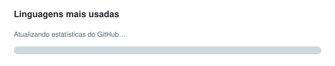

# Olá! Eu sou a Barbara Soares 👋

### 💻 Desenvolvedora em formação | Engenharia de Software

Estou construindo minha carreira na área de tecnologia e atualmente desenvolvendo meus conhecimentos em programação e desenvolvimento web.

Tenho focado meus estudos em **JavaScript**, além de HTML, CSS, Git e GitHub, criando projetos práticos para consolidar o aprendizado.

---

### 🚀 Atualmente estudando

  

### 📊 Linguagens mais usadas no GitHub

  

> Estatística gerada automaticamente a partir do código dos meus repositórios públicos e atualizada pelo próprio GitHub.

### 📚 Próximos estudos

- TypeScript
- React
- Node.js
- PostgreSQL / SQL
- APIs REST

---

### 💻 Projetos em destaque

- 🎮 [Jogo da Velha](https://github.com/barbarasoaress/jogo-da-velha)
- 🧮 [Calculadora Web](https://github.com/barbarasoaress/calculadora)
- 📱 [Gerador de QR Code](https://github.com/barbarasoaress/gerador_QRcode)
- 🕒 [Relógio Digital](https://github.com/barbarasoaress/relogiodigital)

Também mantenho outros projetos de estudo em **JavaScript** e **Python**, acompanhando minha evolução em lógica de programação e desenvolvimento de software.

---

### 📫 Contato

